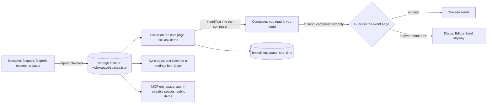
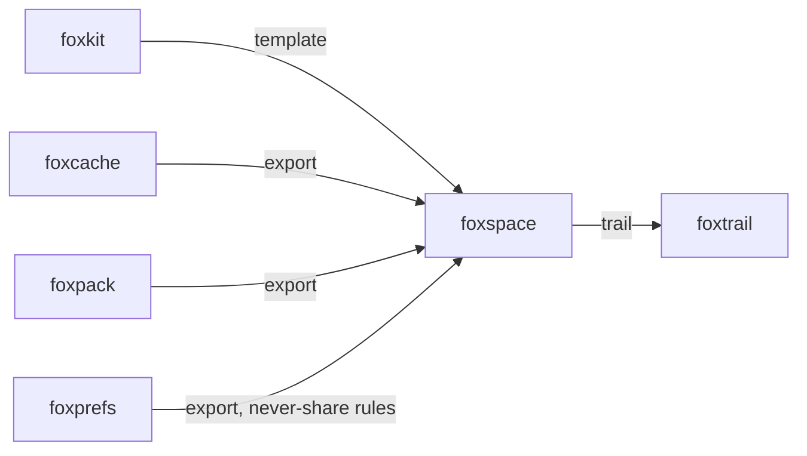

# foxspace

[](https://www.npmjs.com/package/foxspace)
[](https://www.npmjs.com/package/foxspace)
[](https://opensource.org/license/mit)

[Quickstart](#make-your-first-space) · [How it works](#how-it-works) · [API reference](#runtime-surfaces) · [Limits](#limits)

foxspace is an open-source library, CLI, MCP server and Firefox extension for task spaces of AI context.
A space such as "Trip to Japan" holds instructions, memories, preferences and snippets, each marked public, ask or private.
You add a space to the message box on any supported chat site, and foxspace stops a send that holds a term you never share.

## Install

```bash
npm install foxspace
```

The package needs Node.js 24 or later and includes TypeScript declarations.
It has three runtime dependencies: `@modelcontextprotocol/sdk` and `zod` for the MCP server, and `foxtrail` for the extension's trail.
The Firefox extension needs Firefox 153 or later.

## Make your first space

Save this as `example.mjs`, then run `node example.mjs`.
It keeps the spaces in memory. No keys, environment variables or `.env` file are needed.

```js
import { createGuard, createSpaces, memoryStore, renderSpace } from "foxspace";

const spaces = createSpaces({ store: memoryStore() });
const trip = await spaces.create("Trip to Japan");
const { added } = await spaces.addItems(trip.id, [
  { kind: "instructions", text: "Plan by train. Keep each day light.", sensitivity: "public" },
  { kind: "memory", text: "My budget is 3000 CAD." }, // no sensitivity: "ask"
  { kind: "memory", text: "My passport number is AB123456.", sensitivity: "private" },
]);
await spaces.setNeverShare(trip.id, ["AB123456"]);

const space = await spaces.get("Trip to Japan");
console.log(renderSpace(space).text); // the instructions only
console.log(renderSpace(space, { ticked: [added[1].id] }).text); // and the budget, ticked
const guard = createGuard(space.neverShare.map((term) => ({ term, from: space.name })));
console.log(guard("my passport is AB 1234\u200b56").ok); // false: stopped
```

The first block has the instructions. The second also has the budget, because you ticked it.
Neither has the passport number: a private item is never rendered.
The guard finds the term through spaces and a zero-width character.

From a shell, the same spaces are a file:

```bash
npx foxspace import foxcache-export.json --into "Trip to Japan"
npx foxspace render "Trip to Japan" --for chatgpt
npx foxspace guard "my passport is AB123456"   # exit 3: stopped
```

## How it works



1. Each item has a kind (`instructions`, `preference`, `memory`, `snippet`) and a sensitivity.
   An item with none is `ask`. Text with control characters, bidi controls or zero-width spaces is refused.
2. On chatgpt.com, claude.ai, chat.mistral.ai, gemini.google.com, www.perplexity.ai, grok.com and
   chat.deepseek.com, a small foxspace button sits at the composer. Alt+Shift+K (Control+Shift+K on a Mac) opens the same picker.
3. The picker is an extension page in a frame inside a closed shadow root, so the chat page cannot read it.
   Public items always go in, `ask` items only when you tick them, and private items never reach the frame.
   A block that holds one of your never-share terms is not inserted; the picker names the term.
4. Insert puts the block before your text with `document.execCommand("insertText")`, the method of
   [foxpaw](https://github.com/pooriaarab/foxpaw) and foxpilot's PII Guard, so the site's editor gets the
   input events it listens for. foxspace reads the composer back and says so when the site did not take it.
   It never sends the message.
5. At Enter or a click on the send control, the content script sends the composer text to the event page.
   The never-share terms stay there. Both sides are normalized (NFKC, a lookalike map, accents and format
   characters removed), so `AB 1234 56` with a zero-width space in it still matches `AB123456`.
   A send goes out only with the text that was checked; an edit made in the meantime is checked again.
6. Each injection goes to a [foxtrail](https://github.com/pooriaarab/foxtrail) log in IndexedDB, shown on the spaces page.

## Why it exists

People keep context for a task in one chat site, then start again in the next one.
Each site keeps its own [custom instructions](https://help.openai.com/en/articles/8096356-chatgpt-custom-instructions),
[personal preferences](https://support.claude.com/en/articles/10185728-understanding-claude-s-personalization-features) or
[saved info](https://support.google.com/gemini/answer/16598625), in its own account, with no level per item.
foxcache captures that context into your browser; foxspace lets you use it on any of the sites,
item by item, and stops what you said you never share.

## Compare

Checked on 2026-10-15 against the linked pages.

| Item | foxspace | ChatGPT custom instructions | Claude personal preferences | Gemini instructions |
|---|---|---|---|---|
| Where data lives | Your browser or a local file | The OpenAI account | The Anthropic account | The Google account |
| Works on | 7 chat sites | ChatGPT | Claude | Gemini |
| Per task | One space per task | One set for all chats (Projects aside) | One set for all chats (Projects aside) | One list for all chats (Gems aside) |
| Per item level | `public`, `ask`, `private` | None | None | None |
| Stops a never-share term at send | Yes | No | No | No |
| Size limit | Composer: 8,000; Sync: per box | 1,500 (Free, Go) or 5,000 (paid) | Not documented | Not documented |

## Runtime surfaces

### Library

| Export | What it does |
|---|---|
| `createSpaces({ store, now? })` | The spaces object: `list`, `get` (id or name), `create`, `rename`, `setAgentReadable`, `remove`, `addItems`, `updateItem`, `removeItem`, `setNeverShare`, `addNeverShare`, `addSpaces`, `export`. |
| `memoryStore()`, `storageAreaStore(area, key?)` | Stores in memory, or in a WebExtension area such as `browser.storage.local`. |
| `renderSpace(space, { ticked?, format?, limit?, kinds? })` | `{ text, included, left, empty? }`. Plain text or Markdown. Whole items that do not fit are left out and counted. |
| `renderForSync(space, provider, box, { ticked?, format? })` | The same, sized for one settings box. |
| `PROVIDERS`, `INJECT_LIMIT` | The seven sites with their settings boxes, limits and where each limit comes from. |
| `createGuard(terms)` | Returns `(text) => { ok, matches, tooLong }`. |
| `normalizeForGuard(text)` | The form both sides are compared in. |
| `parseImport(json)`, `parsePaste(text, kind, sensitivity?)` | Read an export or pasted text into items. See [docs/formats.md](docs/formats.md). |
| `SITES`, `siteForHost(host)` | The composer and send selectors per site ([docs/sites.md](docs/sites.md)). |
| `FoxspaceError` | Has a `code`: `bad-space`, `bad-store`, `bad-import`, `too-large`, `not-found`, `bad-request`. |

`foxspace/node` has `openSpaces({ env? })` and `fileStore(path)`.

### CLI

```text
foxspace list                                   foxspace show <space>
foxspace render <space> [--markdown] [--tick <item>...]
foxspace render <space> --for <provider> [--box <box>] [--markdown] [--tick <item>...]
foxspace import <file> [--into <space>]         foxspace guard <text...>   (- reads stdin)
foxspace mcp
```

The store is `$FOXSPACE_HOME/spaces.json`, by default `~/.foxspace/spaces.json`. The directory is
`0700` and the file `0600`. `show` masks private text. Exit codes: 0 done, 1 a foxspace error,
2 bad usage, 3 the guard found a term.

### MCP server

`foxspace mcp` serves two read-only tools over stdio:

| Tool | What it returns |
|---|---|
| `list_spaces` | The spaces you marked agent-readable: id, name, number of public items. No content. |
| `get_space` | One agent-readable space, public items only, as text or Markdown. An agent cannot tick an `ask` item. |

```json
{ "mcpServers": { "foxspace": { "command": "npx", "args": ["foxspace", "mcp"] } } }
```

### Firefox extension

- The spaces page (the add-on options) lists and edits spaces: items with their level, never-share
  terms, import of a pasted export or a file, export, and the recent injections.
- The picker and the guard dialog are frames on the chat page. The sync page renders a space for a
  settings box, with Copy and a link to the site's settings.
- The only permission is `storage`. The content script runs on the seven sites only.

```bash
pnpm install
pnpm build:ext    # dist-ext/; load it from about:debugging
pnpm e2e          # local Firefox, or FOXKIT_BROWSER=ichabod with ICHABOD_API_KEY
```

The E2E serves synthetic copies of chatgpt.com, claude.ai and chat.deepseek.com through
WebDriver BiDi network interception, so the content script runs on the real origins.

## Limits

- The selectors were checked against public reports on 2026-10-15, not against live logged-in
  sites. A redesign can hide the composer; foxspace then says so and inserts nothing.
- The guard sees what the composer holds at Enter or at a click on the send control. It does not
  see a send by another key or control, a file or image upload, an edit of an earlier message,
  or voice input.
- Paste-and-send race: when a site sends from its own handler before foxspace reads the
  composer (for example a send on `keyup`, or from a script), the text is not checked.
- A composer inside a closed shadow root, or one that sends on Enter inside a shadow root
  foxspace cannot see into, is not guarded.
- "Send anyway" replays the send with a click on the send control or a synthetic Enter. A site
  that checks `isTrusted` ignores the replay; you then send again yourself.
- The lookalike map covers common Cyrillic and Greek letters, not the whole Unicode confusables
  table. Digits of other scripts (for example Arabic-Indic) are not folded.
- Sync does not write into the site's settings. You copy the text and paste it. Automating that
  is future work. Several limits are not documented by the sites; foxspace then uses 1,500.
- foxcache and foxpack do not publish their export formats yet. [docs/formats.md](docs/formats.md)
  lists the shapes foxspace reads.
- "Private" is about chat sites and agents, not about this computer. `~/.foxspace/spaces.json`
  and an export file hold private items in plain JSON.
- No sync between devices. The extension and the CLI use separate stores; move data with export and import.

## Part of the fox primitives



## License

[MIT](LICENSE)
